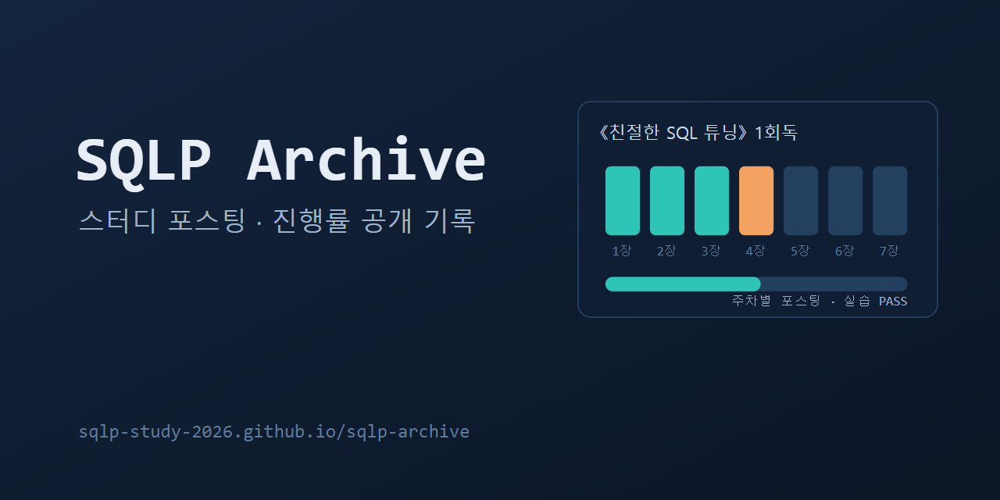

# SQLP 스터디 아카이브

《친절한 SQL 튜닝》을 함께 읽고 SQLP를 준비하는 스터디의 **공개 기록**이다.

- 🌐 사이트: https://sqlp-study-2026.github.io/sqlp-archive/
  - 전체·닉네임별 진행률, 성공 기준 달성 여부
  - 주차별 커리큘럼과 실습 문제 설명·스키마
  - 스터디원이 쓴 주차별 포스팅과 받은 리뷰 (포스팅 모아 보기)

제출한 SQL, 판정 기록, 정답 쿼리는 공개하지 않는다. 포스팅 작성자와 리뷰어는 닉네임으로만 표시한다 (단, PR 화면은 GitHub이라 계정 이름이 보인다).

## 스터디원: 포스팅 쓰는 법

포스팅은 이 저장소의 PR로 올린다. **파일과 PR은 봇이 미리 만들어 두므로** 본문만 쓰면 된다.

1. 주차가 시작되면 `[N주차] 닉네임 포스팅` Draft PR이 생긴다 (내 체크리스트 이슈에 링크)
2. PR → **Files changed** → 파일 오른쪽 **⋯ → Edit file** → 본문 작성 → **Commit changes**
   - 맨 위 `---` 사이(주차·챕터·닉네임)는 고치지 않는다
   - 내 파일(`posts/weekNN/<내 path>.md`) 말고 다른 파일은 고칠 수 없다 (PR 체크가 실패한다)
3. 다 쓰면 **Ready for review** → 멘토 리뷰·승인 → 머지되면 사이트에 게시

자세한 사용법: `sqlp-judge` 저장소의 **docs/시작하기.md** (스터디원만 열람 가능)

## 구조

| 경로 | 내용 | 누가 바꾸나 |
|---|---|---|
| `posts/weekNN/<path>.md` | 포스팅 | 스터디원 (PR, 멘토 승인) |
| `data/` | 진행률·문제 설명·작성자 닉네임·포스팅 목록과 리뷰(`posts.json`, 닉네임만) | 봇 (sqlp-judge의 rebuild) |
| `scripts/build_site.py` | `data/`·`posts/`로 사이트 원고 생성 (공개 금지 항목 검사) | 개발 |
| `.github/workflows/` | 포스팅 검사, 진행률 갱신 요청, Pages 배포 | 개발 (멘토 승인) |
